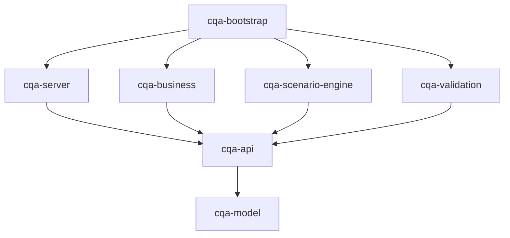

# CQA

CommonQA — сценарное тестирование систем-участников CDI/MDM. Работают создание
и последовательный запуск HTTP-сценариев, assertions/extracts, проверка и проксирование
saveAndMerge, журнал SQLite, REST/SOAP-приветствия и эхо.

## Модули и зависимости

| Модуль | Назначение | Зависимости внутри проекта |
|---|---|---|
| [cqa-model](cqa-model/README.md) | Общие DTO, описания сценариев, параметры, результаты и статусы | — |
| [cqa-api](cqa-api/README.md) | Сервисные интерфейсы и публичные ошибки | model |
| [cqa-validation](cqa-validation/README.md) | Реализация проверки формы через Bean Validation | api, model |
| [cqa-business](cqa-business/README.md) | Прикладные валидаторы, правила и приветствия | api, model |
| [cqa-scenario-engine](cqa-scenario-engine/README.md) | Создание и выполнение сценариев | api, model |
| [cqa-server](cqa-server/README.md) | REST/SOAP, HTTP/JSON/файловые адаптеры, журнал | api, model |
| [cqa-bootstrap](cqa-bootstrap/README.md) | Main, связывание реализаций и исполняемый JAR | все перечисленные модули |



Реализации также напрямую используют типы из `cqa-model`. Между модулями
реализаций зависимостей нет. Spring используется в `server` и `bootstrap`;
корневой POM не импортирует Spring BOM и зависимости. Границы проверяет `ModuleBoundariesTest`.

Контроллеры получают `ScenarioCreator`, `ScenarioEngine`, `Validator<T>` и
`GreetingFacade` из API. Bootstrap выбирает реализации и передаёт их зависимости.
Валидаторы делегируют проверку формы интерфейсу `FormValidator`; наследования
от реализации в другом модуле больше нет. Внутренние runners и реестры остаются в движке.

## Сборка, запуск и проверки

Требуются Java 21+ и Maven 3.9+. Из корня проекта:

```bash
mvn clean verify
java -jar cqa-bootstrap/target/cqa-bootstrap-0.0.4.jar
```

Исполняемый JAR теперь выпускает `cqa-bootstrap`; `cqa-server` собирается как библиотека.
Версия задаётся свойством `revision` в корневом POM. После переноса классов используйте `clean`.

В `verify` входят 6 тестов границ модулей, поведения валидации и совместимости SOAP-ответов с XSD. Проверка собранного приложения
с локальными HTTP-заглушками запускается отдельно (Python 3, без дополнительных пакетов):

```bash
python3 scripts/smoke_scenarios.py
```

Скрипт запускает JAR и мок на временных портах, создаёт временные сценарии и SQLite-журнал,
выполняет 46 проверок и останавливает процессы. Проверяются создание/дубликат/валидация,
успешное выполнение, остановка и продолжение после ошибки, ожидаемый HTTP 503,
ошибка extract, REST/SOAP, обе ветки saveAndMerge и журнал. Артефакты остаются
во временном каталоге, путь выводится в результате. Внешние MDM-системы не используются.

Подробный поток исполнения — [MANUAL.md](MANUAL.md).
Соглашения об именовании Java — [CODE_STYLE.md](CODE_STYLE.md).

## Конфигурация

Все файлы лежат **в корне репозитория**, приложение запускается оттуда же
(`spring-boot-maven-plugin` настроен на `workingDirectory=${project.basedir}/..`).

| Файл              | Что в нём                                                                 | В git |
|-------------------|---------------------------------------------------------------------------|-------|
| `application.yml` | порт, БД журнала, Swagger/Scalar, логи; подключает два файла ниже         | да    |
| `connections.yml` | адреса ручек (`cqa.api.paths.*`), контур и подключения МДМ                | да    |
| `.env`            | значения переменных для контура: адреса, логины, пароли                   | **нет** |
| `.env.example`    | шаблон `.env` со всеми переменными                                         | да    |

Переменная окружения важнее строки в `.env`, строка в `.env` важнее значения по умолчанию.

| Переменная                    | По умолчанию                   | Описание                          |
|-------------------------------|--------------------------------|-----------------------------------|
| `MDM_DEV_URL`                 | — (обязательна для saveAndMerge) | адрес МДМ, контур DEV           |
| `MDM_DEV_REST_SAM`            | — (обязательна для saveAndMerge) | путь saveAndMerge в МДМ         |
| `MDM_DEV_USER`, `MDM_DEV_PASSWORD` | —                         | учётные данные МДМ               |
| `CQA_MDM_SCOPE`               | `DEV`                          | контур МДМ                        |
| `CQA_PATH_SAVE_AND_MERGE`     | `/mdm/saveAndMerge`            | адрес нашей ручки saveAndMerge    |
| `CQA_PATH_GREETING_OPERATOR`  | `/hello`                       | приветствие оператору             |
| `CQA_PATH_GREETING_SERVICE`   | `/helloService`                | приветствие сервису               |
| `CQA_PATH_ECHO`               | `/echo`                        | эхо                               |
| `CQA_PATH_SOAP`               | `/services`                    | все SOAP-операции                 |
| `SERVER_PORT`                 | `8990`                         | порт приложения                   |
| `CQA_DB_URL`                  | `jdbc:sqlite:cqa-journal.db?…` | БД журнала                        |

Без `MDM_DEV_*` приложение стартует, но saveAndMerge ответит 500 «МДМ не настроена».

## Структура репозитория

| Путь              | Что это                                                          |
|-------------------|------------------------------------------------------------------|
| `cqa-*/`          | модули проекта, см. таблицу выше                                  |
| `lib/`            | склад jar-зависимостей по тематикам, см. [README](lib/README.md)  |
| `TZ.md`           | техническое задание                                               |
| `application.yml`, `connections.yml`, `.env.example` | конфигурация, см. выше         |
| `cqa-journal.db`  | БД журнала (создаётся при запуске, в git не попадает)             |
| `logs/`           | логи приложения и резервный файл журнала (в git не попадают)      |
