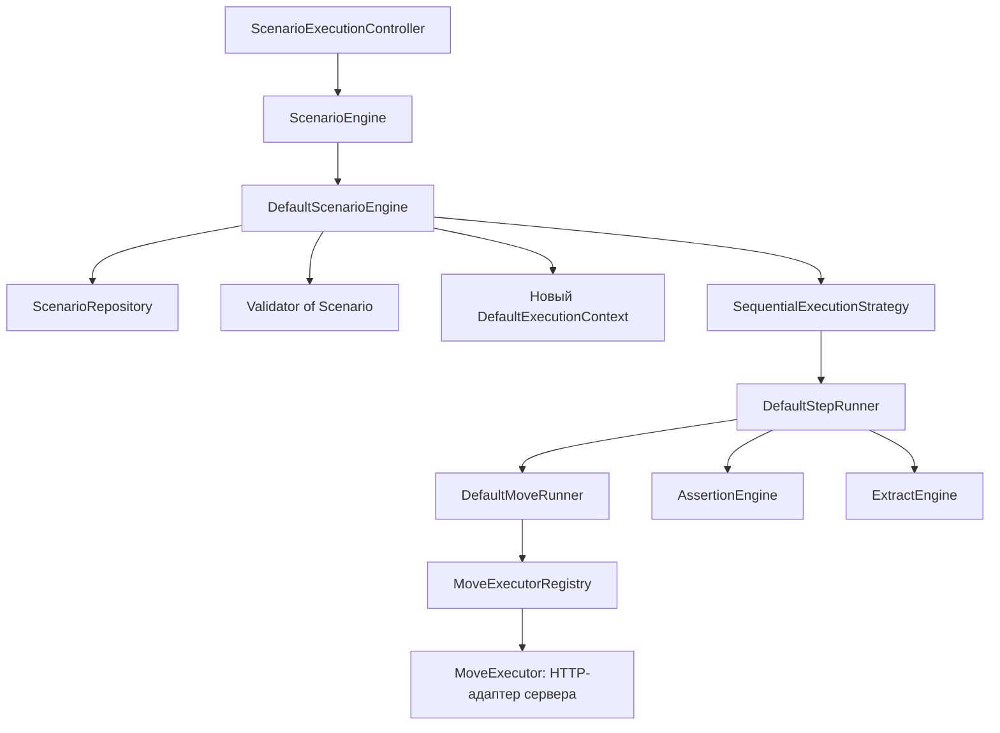

# Архитектура сценарного движка

## Границы

Общие данные находятся в `cqa-model`, публичные порты и ошибки — в `cqa-api`.
Движок реализует сценарные операции и зависит только от этих двух модулей.
Веб-слой также зависит от контрактов; `cqa-bootstrap` связывает реализации.

## Создание

`ScenarioController → ScenarioCreator → ScenarioCreationService`:
JSON разбирается через `ScenarioParser`, проверяется через `Validator<Scenario>`
и сохраняется через `ScenarioRepository`. Реализации JSON и файлового хранилища
находятся в сервере. Повтор UUID+version вызывает `ScenarioAlreadyExistsException`.

## Выполнение

Каждое выполнение получает отдельный контекст с UUID, окружением, переменными
и результатами операций. Адаптеры видят только интерфейс `ExecutionContext`.

Шаги выполняются в порядке JSON-массива. Продолжение после ошибки определяется
`Step.continueOnError` или `Execution.continueAfterFailure`. Внутри шага выполняются
все Move. Ошибка транспорта даёт ERROR; HTTP-коды, включая 4xx/5xx, оценивают assertions.
Проверки `equals` и `notNull` и извлечение `jsonpath` зарегистрированы в bootstrap.
Extract сохраняет значение в контекст, ошибка извлечения даёт ERROR.
При агрегации ERROR приоритетнее FAILED, затем COMPLETED.

## Реализованные адаптеры и ограничения

Сценарии хранятся в JSON-файлах, имя включает UUID и закодированную версию.
HTTP Move поддерживает абсолютный URL или относительный путь с выбором подключения
по `connectionId` и `environmentId`. Секреты остаются во внешней конфигурации.

Модели SQL/Kafka/SOAP существуют, но исполнители не подключены. Общий timeout
сценария, подстановка переменных, предусловия и история прогонов отдельно от
журнала запросов пока не реализованы. Подсистема JAR-плагинов остаётся в пакетах `legacy`.

Для нового внешнего исполнителя используется `MoveExecutor` из API. Внутренние
`StepRunner`, `MoveRunner`, `ExecutionStrategy` и реестры остаются деталями движка.
