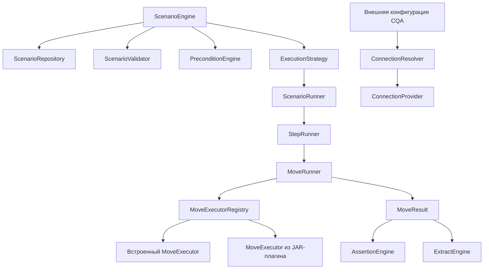

# Архитектура CQA Scenario Engine

## Назначение и границы

`cqa-scenario-engine` задаёт универсальный каркас последовательного исполнения сценариев. Сценарий состоит из версионируемого описания, зависимостей, настроек выполнения и упорядоченных шагов. Шаг содержит операции (`Move`), для которых отдельно определяются исполнители, проверки и извлечения.

Модуль следует соглашению репозитория и использует namespace `ru.cqa.scenario`. Он зависит от нейтрального `cqa-validation`, но не от `cqa-business`, Spring, JDBC, PostgreSQL-драйвера, Kafka-клиента, HTTP-клиента или SOAP-стека. Внешняя инфраструктура подключается через интерфейсы.

Сейчас в модуле есть модели и контракты, простой реестр исполнителей, диспетчеризация assertion/extract и последовательная стратегия. Запуск полного сценария, конкретные операции и адаптеры ещё не реализованы.

## Пакеты

| Пакет | Ответственность |
|---|---|
| `definition.model` | `Scenario`, метаданные, конфигурация выполнения, шаги, зависимости, assertions и extracts |
| `definition.model.move` | типизированные описания HTTP, SQL, Kafka и SOAP операций без клиентов этих протоколов |
| `execution` | контекст запуска, входные параметры, контракты runners и `SequentialExecutionStrategy` |
| `executor` | `MoveExecutor` и реестр встроенных/плагинных исполнителей |
| `plugin` | `ServiceLoader` SPI, реестр возможностей, описание и загрузчик JAR-плагинов |
| `action` | декларации действий и их реестр |
| `repository` | порт хранения сценариев, предназначенный для PostgreSQL-адаптера вне ядра |
| `serialization` | порты разбора и записи JSON, без привязки к конкретной библиотеке |
| `assertion`, `extract` | типизированные расширяемые evaluator/extractor и их диспетчеризация |
| `precondition` | контракты проверки обязательных зависимостей до старта |
| `connection` | ссылки на внешнюю конфигурацию и SPI провайдеров подключений |
| `definition.validation` | специализированный валидатор сценарной модели поверх общего `cqa-validation` |
| `result` | результаты и состояния выполнения |

## Взаимодействие компонентов

Интерфейсы показаны как целевые границы. На данный момент реализованы только последовательное переключение шагов, реестр и диспетчеризация; сборка полного графа через DI-контейнер остаётся ответственностью интеграционного слоя.

## Sequential Execution

`SequentialExecutionStrategy` вызывает переданный `StepRunner` по порядку `Scenario.steps`. Продолжение после неуспешного шага определяется `Step.continueOnError` или общей настройкой `ExecutionConfig.continueAfterFailure`. Стратегия агрегирует статусы и длительность; она не выполняет сетевых, SQL- или брокерных операций. Timeout хранится в модели конфигурации, механизм его применения ещё предстоит реализовать в runner/adapters.

Весь порядок воспроизводим по порядку в JSON-массиве шагов. Параллельные стратегии в каркас не добавлялись.

## Плагины

Встроенные реализации передаются в `DefaultMoveExecutorRegistry` при создании. Внешний JAR может публиковать реализации через `META-INF/services` для `ScenarioPlugin` и/или `MoveExecutorProvider`. `PluginManager.loadPlugins()` просматривает JAR-файлы в заданном каталоге, создаёт для них `URLClassLoader`, находит SPI через `ServiceLoader` и регистрирует исполнители/`ActionDefinition`. Classloader-ы удерживаются до `close()`.

Плагин не получает пароли из `Scenario` или `Move`. Параметры внешнего окружения передаются CQA через `PluginContext`; конкретная политика доверия, подписи и изоляции плагинов не входит в этот каркас.

## JSON и PostgreSQL

JSON — формат сценария для импорта и экспорта. `ScenarioParser`, `ScenarioSerializer` и `MoveDeserializer` являются библиотечно-независимыми портами; реализация Jackson или другой библиотеки может быть добавлена адаптером без изменения моделей ядра.

Модели размечены ограничениями Jakarta Bean Validation с каскадной проверкой вложенных компонентов. `ScenarioValidator` применяет общую последовательность проверки из `cqa-validation` и преобразует нарушения в `ScenarioValidatorException`. Jakarta Validation API доступен через `cqa-validation`; приложение подключает provider и передаёт настроенный `Validator` в конструктор.

`ScenarioRepository` описывает загрузку по UUID и версии, сохранение и удаление. PostgreSQL является выбранным хранилищем, но JDBC/JPA, миграции, транзакции и конкретная схема БД принадлежат инфраструктурному модулю и здесь не добавлены.

## Подключения и секреты

Scenario и Move содержат `connectionId`, а не URL, username, password или token. `ConnectionResolver` получает `ConnectionDefinition` из внешней конфигурации CQA. Конкретный `ConnectionProvider` создаёт нейтральный `ConnectionHandle`; protocol-specific ресурсы реализуются вне ядра. Тест предусловий оформляется через `PreconditionEngine` и `ConnectionChecker`.

## Результаты и проверки

`MoveStatus` отражает итог операции; `StepStatus` и `ExecutionStatus` агрегируют его на следующих уровнях. `AssertionEngine` и `ExtractEngine` выбирают реализации по `type`. Сами evaluator-ы и extractor-ы регистрируются интеграционным слоем.

Модель пока не фиксирует, к какому уровню привязываются `Assertion` и `Extract` (Move или Step), и как отрицательный ожидаемый результат влияет на общий статус прогона. Эти связи оставлены открытыми, без предположений в коде.

## Дальнейшее развитие

1. Утвердить JSON-схему и версии сценария.
2. Определить уровень привязки assertions/extracts и правила негативных сценариев.
3. Реализовать concrete runners и адаптер хранения PostgreSQL вне ядра.
4. Добавлять протокольные исполнители отдельными встроенными адаптерами или JAR-плагинами.
5. Подключить precondition-проверки и resolver внешней конфигурации CQA.
6. Определить политику жизненного цикла и безопасности plugin JAR.
